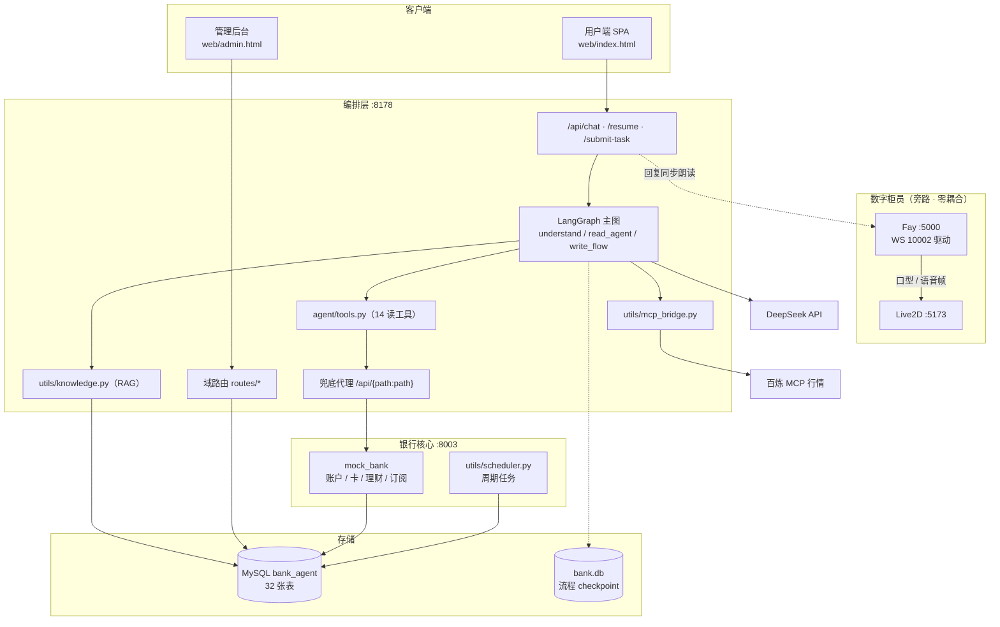
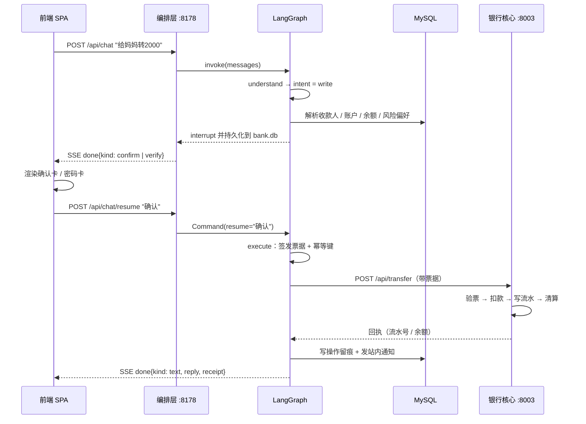
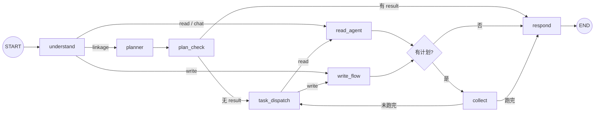
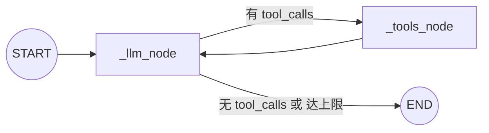
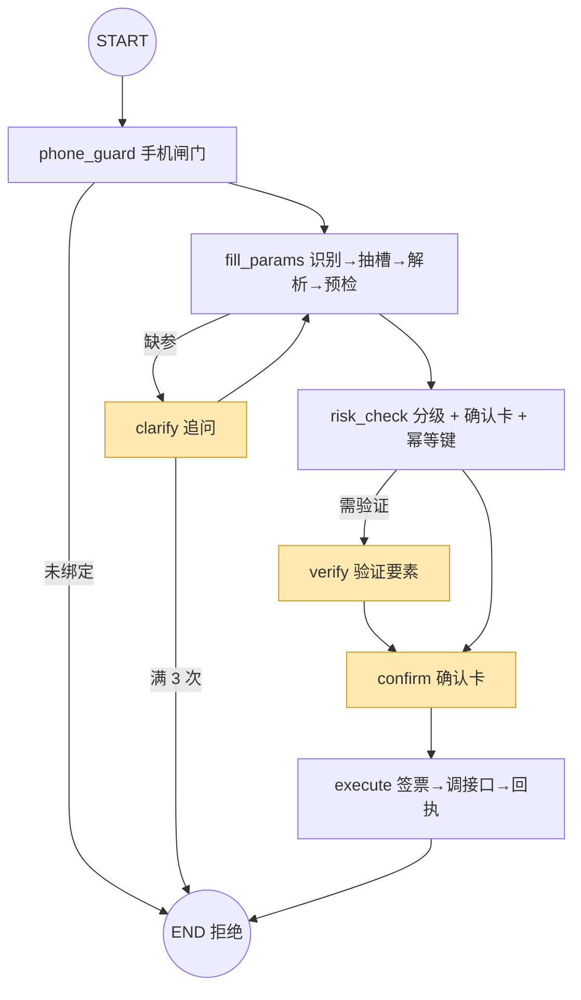
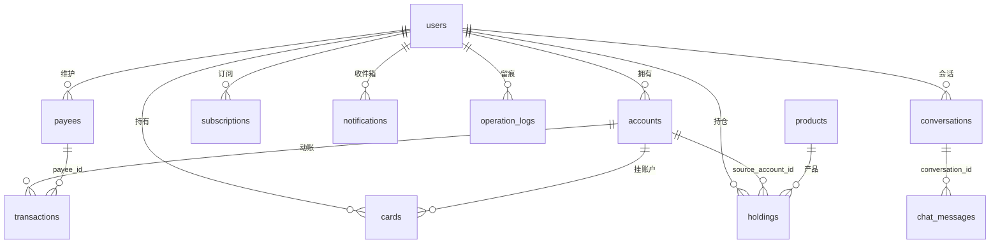

# 小微 AI 银行助手 · 系统设计文档

| 项 | 内容 |
|---|---|
| 文档版本 | v1.0 |
| 更新日期 | 2026-10-12 |
| 对应代码 | `bank-agent/`（本机运行态） |
| 文档定位 | 开发 / 评审 / 答辩用的全景设计说明 |
| 结论口径 | 以当前代码与数据库实测为准 |
| 待办标记 | ⚠️ = 已知问题或与文档不一致处 |

**一句话概括**：用户不点菜单、直接说"给妈妈转 2000"，系统用 LLM 理解意图 → 补齐要素 → 安全核验 → 生成确认卡 → 用户确认 → 调用银行接口落库，全程以进度条实时反馈。

**三个贯穿全局的取舍**

1. **LLM 只做"理解"与"表达"，绝不"执行"** —— 金额/余额/卡号/流水号一律来自工具返回值；限额、适当性、风控分级全部是**代码硬判断**。
2. **写操作必过四关** —— 风控分级 → 验证要素 → 明确确认 → 一次性票据。10 个写动作全部走这条闭环，直连后端写接口无票据直接 401。
3. **演示环境也按生产标准做安全** —— `ENV=production` 时，默认密钥/默认管理员密码会让服务**拒绝启动**。

---

## 目录

| 章节 | 内容 |
|---|---|
| [1 · 项目概览](#1-项目概览) | 技术栈、目录结构 |
| [2 · 系统架构](#2-系统架构) | 分层、进程、路由归属、调用链路 |
| [3 · 核心工作流](#3-核心工作流) | 主图、读流程、写流程、中断恢复 |
| [4 · API 接口设计](#4-api-接口设计) | 约定、端点清单、票据、对话契约 |
| [5 · 数据库设计](#5-数据库设计) | 32 张表、字段意图、迁移机制 |
| [6 · 知识库构建](#6-知识库构建) | 切片、向量、检索、维护 SOP |
| [7 · 安全设计](#7-安全设计) | 令牌、第二要素、绑定闸门、PII |
| [8 · 质量保障](#8-质量保障) | 测试分层、测试原则、未决事项 |
| [附录](#附录-a-关键环境变量) | 环境变量 / 运维命令 / 易忽略的点 |

---

## 1. 项目概览

### 1.1 技术栈

| 层 | 选型 | 落点 |
|---|---|---|
| 前端 | 单文件 React（内联 Babel，无构建链） | `web/index.html`、`web/admin.html` |
| 编排 | FastAPI + LangGraph StateGraph | `run_server.py`（:8178）+ `agent/` |
| 大模型 | DeepSeek `deepseek-chat`（openai SDK） | 全部调用 `temperature=0` |
| 银行核心 | 自建 FastAPI Mock | `mock_bank/`（:8003） |
| 数据库 | MySQL 8（pymysql + DictCursor） | 库 `bank_agent`，32 张表 |
| 流程持久化 | LangGraph `SqliteSaver` | `bank.db`（与业务库物理隔离） |
| 知识库 | 自建轻量 RAG（无独立向量库） | 切片 + 向量存 MySQL |
| 外部行情 | 阿里云百炼 MCP（东方财富妙想） | `utils/mcp_bridge.py`，只读 |
| 数字柜员 | Fay + Live2D（mate-human） | 与业务域零耦合，仅 HTTP 喂话 |

**前端约定**：全站 0 emoji / 0 图标字体；深色科技风 + 日间米金双主题，按用户维度记住偏好。

### 1.2 目录结构

```
bank-agent/
├─ run_server.py        编排层入口：/api/chat* + 域路由 + 兜底代理
├─ config.py            配置单源（.env）＋ 生产安全校验
├─ profile_db.py        用户 / 资料 / 令牌 / 会话消息仓储
├─ rules.py             结构化规则表 RULE_SPECS ＋ 知识文案拼装
├─ init_db.py           建库与迁移台账执行器
│
├─ agent/               ★ AI 编排核心
│   ├─ main_graph.py     主 StateGraph
│   ├─ read_agent.py     读子图（LLM ⇄ 工具循环）
│   ├─ write_flow.py     写子图（8 步 + 3 个中断点）
│   ├─ driver.py         会话驱动 / 挂起恢复 / 逃生舱
│   ├─ prompts.py        提示词常量（能力边界、数据口径）
│   └─ tools.py          14 个只读工具
│
├─ mock_bank/           ★ 银行核心（:8003）
│   ├─ main.py           账户 / 流水 / 收款人 / 转账 / 限额
│   └─ db.py             数据库访问单源 get_conn
│
├─ routes/              编排层域路由（须注册在兜底代理之前）
│   └─ account / wallet / admin / runtime / card_key / risk
│
├─ utils/               领域能力（两个服务共用）
│   └─ paypass / op_auth / verify_codes / knowledge / mcp_bridge
│      scheduler / transfer / wealth / card / subscription / risk
│
├─ web/                 前端
├─ sql/                 init.sql（仅全新库）+ upgrade_*.sql
├─ scripts/             回归测试与运维脚本
├─ docs/                本目录（设计文档集）
└─ data/                形象、外观等可变配置
```

---

## 2. 系统架构

### 2.1 分层视图



### 2.2 进程与端口

| 进程 | 端口 | 职责 |
|---|---|---|
| `mock_bank` | 8003 | 银行核心 |
| `run_server` | 8178 | AI 编排 + 域路由 + 代理 + 前端静态页 |
| Fay | 5000 / 10002 / 10003 | 数字人（控制台 + 驱动 WS） |
| Live2D | 5173 | 数字人画面 |

```bash
# 银行核心
.venv/Scripts/python.exe -m uvicorn mock_bank.main:app --host 127.0.0.1 --port 8003
# 编排层
.venv/Scripts/python.exe -u run_server.py
# 数字人（在 agaent/fay/Fay 下，PYTHONPATH= 必须加）
PYTHONPATH= .venv/Scripts/python.exe -u main.py start
```

> **⚠️ 两个必踩的坑**
> ① 两个 Python 服务**必须免沙箱启动**，否则写 `bank.db` 会报 `readonly database`，表现成"聊天 500"。
> ② 直接跑 `python mock_bank/main.py` 会因 `sys.path` 缺根目录而 `ModuleNotFoundError`，必须用 `-m` 包方式。

### 2.3 路由归属（最容易改错的地方）

编排层按优先级承担三件事：

1. **显式注册的端点** —— `/api/chat*`、`routes/*` 六个域路由、`/api/auth/*`、`/api/op/authorize`、`/api/admin/*`、`/api/card-key/*`、`/api/risk/*`、`/api/digital-human/*`、`/api/appearance/*`、`/api/overview`。
2. **兜底代理** —— `/api/{path:path}` 转发到 8003，保留方法 / body / query。
3. **写接口前置闸门** —— 代理层对写路径先校验"手机已绑定"，未绑定返回 403 `phone_unbound`。

> **★ 铁律 · 顺序**：新增直连域路由**必须注册在兜底代理之前**，否则会被代理吞掉转发到 8003（表现为 404）。`scripts/test_route_split.py` 校验这个顺序。

> **★ 速查 · 改完重启谁**：`routes/wallet.py`（支付密码 / 票据 / 签约直连）在 **8178**；`utils/wealth.py` 的 router（理财买卖）挂在 **8003**。

### 2.4 一次写操作的完整链路



### 2.5 数字柜员集成

Fay 与 Live2D 是完全**旁路的渲染端**：编排层拿到回复文本后喂给 Fay（走 `/transparent-pass` 让它**逐字念出**，而不是让 Fay 自己再答一遍），Fay 再通过 `WS 10002` 推口型与语音帧到 Live2D。

- 业务域**零改动**：`FAY_API_URL` 未配置时，桥接层全部静默 no-op。
- `FAY_USERNAME` 必须与前端连 WS 时注册的 `Username` 一致（默认 `User`），否则"连上了却收不到任何帧"。
- 朗读文本会做**口语化处理**（去 Markdown / emoji、连续列表只念第 1 项），但**聊天区展示的原文不变**。

---

## 3. 核心工作流

### 3.1 主图拓扑



- 主图 **8 个节点**：`understand` / `planner` / `plan_check` / `task_dispatch` / `read_agent` / `write_flow` / `collect` / `respond`。
- **所有条件路由都是代码判断**（`route_after_*` 系列），LLM 只负责产出 `intent`、抽取槽位、生成文本。
- **checkpointer** 用 `SqliteSaver(bank.db)`，挂起态可跨进程恢复；"支付密码已通过"标记同理放进 DB 表 `paypass_passed`。

### 3.2 意图路由与代码兜底

`understand` 由 LLM 判定 `intent ∈ {read, write, linkage, chat}`，但**判完必须过一道代码校正** `_coerce_intent()`。

> **★ 为什么需要兜底**：实测事故 —— 首屏快捷按钮「帮我处理闲置的订阅」被 LLM 判成 `linkage`（多步联动），`planner` 拆成"先查订阅、再处理"两个**读**步骤，流程永远走不到"取消订阅"这个写动作，用户点了等于白点，只收到一句"汇总…→None"。
>
> **校正规则**：intent 为 `linkage` 时，若同时满足
> ① `detect_action()` 或"资产类写动作线索"命中**单一**写动作；
> ② 文本**不含**读类措辞（查/看/列表/分析/发现…）；
> ③ 文本**不含**第二个业务动作（买/理财/赎回/转/归集/签约/冻结）——
> 则**强制改判为 `write`**。真联动（如"取消闲置订阅并入理财"）保持 `linkage`。

### 3.3 读流程（`read_agent`）



**消息组装顺序**：`用户画像 system` → `read_agent 系统提示词` → **RAG 片段（top 3）** → 历史对话。

**四条结构性约束**（每条都是踩坑后写上的）

| 约束 | 不做的后果 |
|---|---|
| 每轮**重新调工具取数** | `temperature=0` 下模型照抄上下文里的旧表格 → "刚买完再问支出"得到买之前的数字 |
| `tool_calls` 与 `tool` **逐 id 配对** | 悬空工具调用 → OpenAI 直接 400 `insufficient tool messages` |
| 工具轮次**硬上限 4** | LLM 反复调工具，前端永远"正在输入" |
| 剥历史时，含正文 + tool_calls 的 assistant **也要摘掉 tool_calls** | 同上第 2 条 |

> 实现：`_strip_stale_tool_plumbing()`（只保留本轮工具往返）+ `_drop_dangling_tool_calls()`（配对校验兜底），两函数串联在 `read_agent._llm_node`。

### 3.4 写流程（`write_flow`）



**风控分级**（`_verify_queue`）—— 什么动作要什么要素

| 动作 / 场景 | 验证要素 |
|---|---|
| 转账 ≤ ¥2,000 且收款人常用 | 支付密码 |
| 转账 > ¥2,000 或非常用收款人 | 验证码 + 支付密码 |
| 转账 > ¥20,000 或新收款人大额 | 双要素 + 大额警示行 |
| 买理财 | 恒需支付密码 |
| 赎回理财 | 支付密码 |
| 归集（本人账户间） | 支付密码（免验证码） |
| 签约代扣 | 恒需支付密码 |
| 冻结 / 解冻 / 挂失 / 注销卡、取消订阅 | 按金额与场景分级 |

> **说明**：理财的 `wealth_verify_threshold`（¥10,000）**已降级为"大额警示"**，不再决定是否免密 —— 投资行为按金额给免密通道等于留口子。

**三个关键节点的设计**

- **`clarify` 追问**：缺参数问一次，最多 3 次；所有追问末尾统一追加「（回复「取消」可随时退出本次办理…）」，保证用户有明确退出通道。
- **`risk_check`**：同时做三件事 —— 算出验证队列、**预生成确认卡**（展示收款人/金额/手续费）、生成固定 `Idempotency-Key`。
- **`execute`**：① 进程内签发 `X-Op-Token`（scene 与动作绑定）→ ② 携票据 + 幂等键调 8003 写端点 → ③ 成功后写 `operation_logs` + 发站内收件箱回执。

> **★ 验证码故意"复用旧码"**：`verify_codes.issue_code(reuse_if_valid=True)`，同一 scene 已有未过期验证码时**原样复用**。因为 LangGraph 恢复会重放节点，换码会让"用户刚拿到并输入的码"瞬间作废。

### 3.5 中断与恢复（Human-in-the-Loop）

`interrupt()` **只用在 `write_flow` 的三个点**：`clarify` / `verify` / `confirm`。

| 挂起 kind | 触发 | 有效回答 |
|---|---|---|
| `clarify` | 缺参数 | 候选序号 / 短名字 / 补充信息 |
| `verify` | 需要验证要素 | 4–8 位验证码，或密码占位符 |
| `confirm` | 生成确认卡 | 确认 / 取消 |

**★ 逃生舱（本项目最反直觉、最不能改错的一处）**

用户在挂起状态下发新消息（例如挂着"取消订阅"时突然说"帮我买理财"），若系统只会"把它当成对上个问题的回答"，用户就被**锁死在旧流程里**。采用的判定是**反向判定**：

> **只接受结构化答案，其余一律先 `resume("取消")` 优雅退出旧流程、再按新消息正常处理**（都在 `execute` 之前，零副作用）。

结构化答案的定义：confirm → 确认/取消；verify → 4–8 位数字或密码占位符；候选清单 → 纯序号或短名字；通用澄清 → ≤20 字且不含问号。**外加最强信号：新消息能被 `detect_action()` 识别出另一个写动作 → 直接放行。**

> **⚠️ 禁止改回正向启发式**（"看起来像问句才放行"）。旧实现会吞掉"帮我签约…"这类陈述句/祈使句，用户被锁死循环。`scripts/test_suspend_escape.py`（21 例）专门守这条。
>
> `/api/chat/resume` **故意不加**逃生舱 —— 它是确认卡/验证卡的显式回答通道。

### 3.6 SSE 事件契约

对话接口有 JSON 直返与 SSE 两种；SSE 帧格式 `data: {json}\n\n`，空闲 1s 发 `: keepalive` 保活。

| `type` | 何时发 | 关键字段 |
|---|---|---|
| `thread` | 提交任务/恢复的首帧 | `thread_id`、`conversation_id` |
| `node` | 写流程每步开始/结束 | `node` `label` `phase` `step` `total` |
| `tool` | 调外部 MCP 工具 | `id` `name` `label` |
| `status` | MCP 超 8s | `text` |
| `tool_result` | MCP 返回 | `id` `name` `elapsed_s` |
| `done` | 本轮结束 | `payload.kind`（text / verify / confirm）、`reply`、`receipt`、`nav` |
| `error` | 异常 | `detail` |

`node` 事件由 `write_flow._emit_node()` 经进程内 `event_bus` 发布，`CHAIN_ORDER` 固定 **7 步**，保证进度条不倒退。

### 3.7 MCP 实时数据桥

`utils/mcp_bridge.py` 把阿里云百炼 MCP 工具**转成 OpenAI function calling 格式**，读流程遇到 `mcp_` 前缀工具即真实调用（只读）。

- 熔断：连续失败 5 次标记不可用；超时 30s；慢调用 >8s 推 `status` 事件。
- 不可用时 `get_openai_tools()` 返回 `[]` → 工具列表**动态降级**，不影响本地查询对话。

---

## 4. API 接口设计

### 4.1 总体约定

| 主题 | 设计 |
|---|---|
| 身份 | `Authorization: Bearer <token>`；签名/过期不对一律 401，**绝不静默降级**成全站默认用户 |
| 票据 | 写操作必需 `X-Op-Token`：一次性 + 绑 scene + 默认 300s |
| 幂等 | 写请求带 `Idempotency-Key`，落 `idempotency_records` 防重复提交 |
| 错误 | 统一 `{ok:false, error\|detail, code?}`；业务拒绝不抛 500 |
| 金额 | 一律 `DECIMAL`，禁止 float 参与累加 |

### 4.2 编排层（:8178）

**对话与任务**

| 端点 | 用途 |
|---|---|
| `POST /api/chat` | 对话，JSON 直返 |
| `POST /api/chat/stream` | 对话，SSE 带进度 |
| `POST /api/chat/submit-task` | 前端表单直提为写任务（SSE） |
| `POST /api/chat/resume` | 恢复挂起（确认 / 验证码 / 澄清） |
| `GET /api/state` | 侧栏聚合状态 |

**认证与资料**（`routes/account.py`）

| 端点 | 用途 |
|---|---|
| `POST /api/auth/login` · `/guest` · `/register` | 登录 / 游客（仅 dev）/ 注册 |
| `GET|PUT /api/profile` | 用户画像 |
| `POST /api/profile/phone/bind-request` · `/bind-confirm` | 手机绑定两步 |
| `GET /api/conversations` · `/{id}/greeting` · `/{id}/messages` | 会话与消息 |
| `DELETE /api/conversations/{id}` | 删除会话 |

**钱包与安全**（`routes/wallet.py`）

| 端点 | 用途 |
|---|---|
| `GET /api/overview` | 首页概览 |
| `GET /api/inbox` · `/inbox/unread_count` | 收件箱 |
| `POST /api/inbox/{id}/read` · `/inbox/read_all` | 已读 |
| `POST /api/verify/send` · `/verify/check` | 验证码下发 / 校验 |
| `POST /api/pay/password/verify` · `/set` · `GET /status` | 支付密码 |
| `POST /api/op/authorize` | 签发票据 |
| `POST /api/accounts/transfer-internal` | 归集（本地签票后转发 8003） |
| `POST /api/subscriptions/contract` | 签约（同上） |
| `POST /api/realname/send_code` · `/confirm` | 实名 |

**后台**（`routes/admin.py`）

| 端点 | 用途 |
|---|---|
| `GET /api/admin/{overview, stats/trends, users, verify-codes, logs, config, roles, me, products, knowledge, admin-logs}` | 查询族 |
| `PUT /api/admin/config/{key}` · `/products/{id}` | 改配置 / 产品 |
| `POST /api/admin/users/{id}/{lock,reset-paypass,role}` | 用户运维 |
| `POST /api/admin/knowledge/rebuild` · `/knowledge/{doc}/sync-confirm` | 知识库 |
| `DELETE /api/admin/users/{id}` | 删用户 |

**运行时 / 卡密 / 风控**

| 端点族 | 用途 |
|---|---|
| `/api/digital-human/{status,mute,interrupt}` · `/api/appearance*` · `/api/housekeeping` | 数字人、形象、调度状态 |
| `/api/card-key/{generate,void,redeem}` · `/batches` · `/my-redeems` | 卡密 |
| `/api/risk/{rules,events,my-events}` · `/events/{id}/handle` | 风控 |

### 4.3 银行核心（:8003）　★ = 需 `X-Op-Token`

**账户与流水**

| 端点 | 用途 |
|---|---|
| `GET /api/balance` · `/api/accounts` | 余额 / 账户列表 |
| `GET /api/transactions` | 流水 + 汇总（含 `summary.wealth`） |
| `GET /api/transactions/summary` | 按区间/分类聚合 |
| `GET /api/payees` · `/api/bank-directory` · `/api/payees/check` | 收款人相关 |
| `POST /api/payees/create` | 新增收款人 |
| `GET /api/transfer/limit` · `/api/transfer/fee-quote` | 限额 / 手续费试算 |
| ★`POST /api/transfer` | 对外转账 |
| ★`POST /api/accounts/transfer-internal` | 本人账户归集 |
| `GET /api/settlements/return-history` | 跨行退票历史 |

**卡域**（`utils/card.py`）

| 端点 | 用途 |
|---|---|
| `GET /api/cards` · `/{id}/cardno` · `/api/card/validate` | 查询 |
| `POST /api/cards/apply` · `PUT /api/cards/adjust_limit` | 申请 / 调额 |
| ★`POST /api/cards/{freeze,unfreeze,report-lost}` | 状态机三动作 |
| `DELETE /api/cards/{id}` | 注销 |

**理财与订阅**

| 端点 | 用途 |
|---|---|
| `GET /api/products` · `/api/holdings` | 产品 / 持仓 |
| ★`POST /api/products/buy` · ★`POST /api/redeem` | 申购 / 赎回 |
| `GET /api/subscriptions` · `/discover` | 订阅列表 / 识别 |
| ★`POST /api/subscriptions/contract` | 签约代扣 |
| ★`POST /api/subscriptions/{id}/cancel` | 取消订阅 |
| `PUT /{id}` · `DELETE /{id}` · `POST /discover/{confirm,ignore}` | 变更 / 忽略 |

### 4.4 票据（op-token）的三条签发路径

| 路径 | 场景 | 前置条件 |
|---|---|---|
| **图内签发**（生产主路径） | 对话写流程执行前 | 图中已完成验证要素核实 |
| **HTTP `/api/op/authorize`** | 对话之外的合规调用 / 测试 | `paypass.has_passed` 为真 + 该 scene 近 5 分钟验证码已核验 |
| **域路由内签发** | 前端表单直连（归集、签约） | 先校验"支付密码已通过"，再补票转发 8003 |

> 直连 8003 写端点不带票据 → **401**（`scripts/test_op_auth_negative.py` 覆盖）。这是防"绕过编排直接改钱"的核心闸门。

### 4.5 对话接口契约

```jsonc
// POST /api/chat
{ "thread_id": "web", "message": "给妈妈转 2000" }

// POST /api/chat/resume
{ "conversation_id": "web", "thread_id": "…", "resume": "确认" }
// resume 也可为 "123456"（验证码）或 "[已输入支付密码]"（占位符）

// POST /api/chat/submit-task（前端表单 → 写任务）
{ "conversation_id": "web",
  "task": { "type": "write", "action": "buy_product",
            "params": { "product_id": 1, "amount": 1000, "from_account_id": 49 } } }
```

- `/api/chat` 返回 `{reply, kind, nav?, suspended?, …}`；其余三个返回 `text/event-stream`。
- **挂起态由前端渲染**：`kind:"verify"` → 密码卡/验证码框；`kind:"confirm"` → 确认卡。密码**永不进对话与 checkpoint**，前端只回传固定占位符。

---

## 5. 数据库设计

### 5.1 表总览（MySQL 8 · 库 `bank_agent` · 32 张）

**账户域**（9）
`users` 账号 · `accounts` 账户 · `transactions` 流水 · `payees` 收款人 · `pending_settlements` 跨行在途 · `external_accounts` 他行账户 · `bank_directory` 银行目录 · `transfer_daily_quota` 每日额度 · `balance_reconcile` 对账基线

**卡域**（1）· **理财域**（2）· **订阅域**（1）
`cards` 银行卡 · `products` 产品 · `holdings` 持仓 · `subscriptions` 订阅

**安全与审计域**（7）
`operation_logs` 操作留痕 · `verification_codes` 验证码 · `op_tickets` 一次性票据 · `login_attempts` 登录失败 · `paypass_passed` 密码已通过标记 · `idempotency_records` 防重放 · `notifications` 站内收件箱

**对话域**（3）· **后台域**（8）· **元数据**（1）
`conversations` · `chat_messages` · `knowledge_chunks` · `admin_logs` · `system_config` · `risk_rules` · `risk_events` · `risk_event_views` · `card_keys` · `card_key_batches` · `card_redeem_throttle` · `schema_migrations`

### 5.2 核心表字段与设计意图

**`users` —— 账号与安全状态**

| 字段 | 说明 |
|---|---|
| `username` / `password_hash` | 登录凭据（pbkdf2-sha256） |
| `pay_password_hash` | 第二要素**独立哈希**；只服务端核验，绝不进对话记录 |
| `pay_pwd_attempts` / `pay_pwd_locked_until` | 防爆破状态机：错 3 次锁至当日 23:59:59，**锁定过期即计数归零** |
| `phone` / `phone_tail` / `phone_pending` | 完整号仅后端用；前端只显示尾号 |
| `preferences` | 风险偏好等画像（适当性校验输入） |
| `role` | `user` / `admin` / `risk_ops` / `super_admin` |

**`accounts` —— 钱在这里**
`account_type`(debit/credit) · `is_primary`（每人唯一主账户）· `balance DECIMAL(14,2)` · `card_no`（虚拟卡号，Luhn）。信用账户共享额度、不参与收付。

**`transactions` —— 最核心的表**

| 字段 | 设计意图 |
|---|---|
| `type` | 资金方向：expense / income |
| `category` | 分析维度：餐饮/购物/交通/娱乐/订阅/转账/收入/**理财** |
| `amount` | 恒为正，方向看 `type`；DECIMAL(12,2) |
| `settle_status` | 跨行清算状态机：NULL / pending / settled / returned |
| `payee_id` | 结构化收款人，供风控判定"非常用收款人" |
| `account_id` | 本表**没有** `user_id`，按账户收口 |

> **★ 账单口径（重要）**：`category='理财'` 的流水是**内部划转**（钱在"活期账户 ↔ 名下持仓"间搬动，净资产不变），因此
> **不计入总支出/总收入/分类占比**，单独汇总为 `summary.wealth{buy, sell, net_buy, count}`。
> 否则"本月支出"会被大额申购淹没（实测曾出现 99.7% 都是理财）。**转账不排除**（钱真的付给了别人）。

**`holdings` —— 理财持仓**
`amount` 本金 · `status` holding/redeemed · **`source_account_id`** 申购时的扣款账户，赎回**回款到它**（存量 NULL 时兜底到默认账户）。

**其他关键表**

| 表 | 要点 |
|---|---|
| `payees` | 站内与跨行**共用一张表**，靠 `linked_user_id` / `account_id` 是否为空区分 |
| `subscriptions` | `source` = `contracted`（签约）/ `identified`（流水识别） |
| `verification_codes` | **只存 `code_hash`**；`notification_id` 双写指向收件箱 |
| `operation_logs` | 写端点必写，与业务**同事务**（防止"钱动了没留痕"） |
| `system_config` | 可调参数单源；带 `affects_knowledge` / `docs_ref` 字段 |
| `paypass_passed` | 短 TTL(120s) + **一次性消费**；放 DB 才有跨进程可见性 |

### 5.3 关系图（核心）



### 5.4 迁移与初始化

```bash
python init_db.py                 # 全新库：init.sql + 全部迁移
python init_db.py --upgrade-only  # ★存量库日常用这个：只跑未应用的迁移
python init_db.py --status        # 只读打印迁移台账
```

- 台账表 `schema_migrations` 按文件 **sha256** 判定"是否已应用" —— **文件改动不会自动重跑**（改了已应用的迁移必须新建文件）。
- **安全闸门**：库内 `users` 已有数据、台账为空且非全新库 → **拒绝执行**（部分迁移非数据幂等，如 `upgrade_products_fix.sql` 会 `DELETE FROM products` 重插）。

> **⚠️ `sql/init.sql` 含 `DROP TABLE` 并重灌种子数据，绝不可对存量库全量执行。**
>
> **⚠️ 已知问题**：`sql/upgrade_wealth_source_account.sql` **未登记进 `init_db.py::UPGRADE_ORDER`**，会触发"未登记顺序"告警，建议补登记。

### 5.5 关键约定与坑

| # | 约定 | 说明 |
|---|---|---|
| 1 | 金额一律 `DECIMAL` | 统一 `Decimal` + `ROUND_HALF_UP`，浮点累加会出现 0.01 级误差 |
| 2 | 软删除保留行 | `cards.deleted_at`、`holdings.status`、`subscriptions.status` |
| 3 | 删用户走 `delete_user_cascade` | 逐表显式删除，兼容旧库 + 出审计行数 + 防删最后一个管理员 |
| 4 | `chat_messages.conversation_id` | 是 **VARCHAR(64) 字符串列**（值形如 `web-xxxx`），不是数值列 |
| 5 | 注册即开户 | `create_user` 只写 `users`；`provision_new_user()` 同事务补齐账户/卡/收款人/流水/订阅 |
| 6 | uid 复用坑 | uid 名下若有残留数据，provision 的幂等闸门会**静默跳过**，新用户会"继承"死账号数据 |
| 7 | 收口键不统一 | `transactions` 靠 `account_id`、`chat_messages` 靠 `conversation_id`，写清理脚本易漏 |

---

## 6. 知识库构建

### 6.1 知识源与写作规范

知识源**不在本仓库内**，在工作区根 `agaent/docs/knowledge/`：

| 文件 | 主题 |
|---|---|
| `README.md` | 索引（**不参与检索**），含各文档主题与关键数字摘要 |
| `account-security.md` | 账户安全：6 位密码、错 3 次锁定、验证码有效期 |
| `knowledge-boundaries.md` | 知识边界与安全引导（不代答清单、统一口径） |
| `risk-disclosure.md` | 风险揭示（R1/R2/R3、不保本） |
| `service-scope.md` | 业务办理须知 |
| `subscription-faq.md` | 订阅与代扣 |
| `transfer-rules.md` | 转账规则（¥50,000 限额、0.1% 费率、¥1 起） |
| `wealth-products.md` | 理财产品说明 |

**写作规范**（不是审美要求，而是**为了被程序正确解析**）

1. 首行固定 `适用范围：小微银行（演示环境）`；
2. 每篇用 `## 一、二…` 固定小节 —— **切片是按 `##` 切的**，乱用标题会导致切片破碎；
3. **数字规则一律加粗**（`**¥50,000**`）—— 索引脚本用 `**…**` 正则抽"关键数字摘要"；
4. 跨文档的关键数字**必须一字不差**；
5. 边界声明集中在 `knowledge-boundaries.md`。

### 6.2 切片与向量化（自建轻量 RAG）

| 环节 | 实现 | 要点 |
|---|---|---|
| 切片 | `knowledge._chunk_text` | 按 `##` 切；< 80 字与前片合并；> 1200 字按空行二次切 |
| 向量化 | 百炼 `text-embedding-v3`（**1024 维**） | 失败则向量落 NULL，**不阻塞入库** |
| 存储 | MySQL `knowledge_chunks` | 向量以 JSON 存在行内 —— 规模不大时比引入向量库更简单，且天然持久 |
| 重建 | `knowledge.rebuild()`；后台「知识库 → 重建索引」 | 先重写 README 索引表，再重建切片 + 向量 |

### 6.3 检索与注入（按需注入，不是全量塞）

```python
# agent/read_agent.py::_llm_node
_snips = knowledge.snippets_for_prompt(_last_user, top_k=3)
if _snips:
    messages.insert(1, {"role": "system", "content": _snips})
```

- **触发**：读流程每轮组装消息时，用**用户最后一句**检索，取 **top 3**。
- **相似度下限 0.65**：低于此值不注入。取值来历 —— 噪声上限 0.636 与有效下限 0.713 之间取中。
- **降级链**：向量余弦 → 失败/超时 → **本地 bigram 关键词打分**（检索永不中断）。
- **性能防护**：纯寒暄直接跳过；query 结果 LRU 缓存；嵌入超时收紧到 **4s**。
- **进程内缓存**：切片 + 向量缓存 **30s TTL + 行数变化检测**。

> **⚠️ 别把相似度下限调回 0.30** —— 实测那个值下，"你好呀"都能匹配到"诈骗话术识别"片段：纯噪声，还拖慢生成。

> **★ 维护要点（最容易踩的一条）**：**改了 `docs/knowledge/*.md` 必须重建索引**，否则库里还是**旧切片 + 旧向量**，检索结果不会变。重建完成后进程内缓存 ≤30s 自动刷新，**不需要重启服务**。

### 6.4 结构化规则表（`rules.py::RULE_SPECS`）

规则是"知识"的可计算部分，与知识文档**双向绑定**：

| 字段 | 作用 |
|---|---|
| `default` / `min` / `max` / `type` / `unit` | 参数定义与校验边界 |
| `knowledge: True` | 该参数影响知识文档 → 后台改完打 **`pending_sync` 红标** |
| `docs: "transfer-rules.md"` | 指向需要同步的知识文档 |

带 `knowledge=True` 的参数共 **11 个**：转账三档阈值 + 日限额 + 费率/最低/最高、理财大额警示阈值、支付密码最大尝试次数、验证码 TTL 与最大尝试次数。

**后台链路**：`PUT /api/admin/config/{key}` → `set_rule_value()`（校验范围 → 写 `system_config` → 刷新缓存）→ 写 `admin_logs` 时带 `pending_sync` → 运营同步完文档后 `/sync-confirm` 清标记。

> **⚠️ `sync-confirm` 只清标记，不会自动改知识文档** —— 数字改了、文档没改就会造成口径漂移（知识库说 ¥50,000、系统实际 ¥30,000）。这是流程上的人为风险点。

### 6.5 能力边界与"三方同步"

能力边界用三层表达，**三处必须严格相等**：

| 层 | 载体 | 内容 |
|---|---|---|
| 提示词层 | `agent/prompts.py` | 支持/不支持的诉求白名单；不支持的必须如实说"这个我办不了"并给页面指引 |
| 代码层 | `tools.py::LOCAL_TOOLS`（14 读工具）、`write_flow.py::ACTION_SPECS`（10 写动作） | 能力清单的实现 |
| 知识层 | `knowledge-boundaries.md` | 不代答清单与统一口径，经 RAG 注入作原文依据 |

> **★ 铁律**：`read 白名单 == LOCAL_TOOLS`、`write 白名单 == ACTION_SPECS.keys()`、每个工具都有实现。门禁脚本 `scripts/test_tool_coverage.py`。
>
> **★ 严禁**说"回复即可，系统会带您办理" —— 那是空头承诺。实测事故：用户说"签约代扣"被系统错误映射成"取消订阅"流程。历史事故与排查过程见 `docs/tool_coverage_audit.md`。

### 6.6 增量维护 SOP

新增一类业务知识或规则时，按顺序动这些地方：

1. 写/改知识文档 `agaent/docs/knowledge/xxx.md`（守规范：首行 / `##` 小节 / 数字加粗）；
2. 若含可调数字：在 `RULE_SPECS` 加 key（带 `knowledge=True, docs="xxx.md"`），业务代码改走 `get_rule()`；
3. **重建索引**：后台「知识库 → 重建索引」，或 `rebuild_knowledge_index.py` + `knowledge.rebuild()`；
4. 若新增读工具/写动作：同步 `LOCAL_TOOLS` + `TOOL_IMPLS` + `ACTION_SPECS` + `prompts.py` 两处白名单；
5. 回归：`test_tool_coverage.py`（三方同步）+ `_knowledge_audit.py`（召回体检）。

**生效判定速查**

| 改了什么 | 怎么生效 |
|---|---|
| 知识文档 `*.md` | **重建索引**（≤30s 自动刷新，无需重启） |
| 规则**数值** | 后台保存即生效（DB + 5s 缓存） |
| **代码**（prompts 常量、RULE_SPECS 新增 key） | **重启 8178** |
| 前端 `web/*.html` | 刷新页面 |

---

## 7. 安全设计

### 7.1 身份与凭据

| 机制 | 要点 |
|---|---|
| 登录令牌 | HMAC 签名、24h TTL；**带 token 但签名/过期不对 → 401，不回落默认用户** |
| 匿名回落 | `BANK_ALLOW_ANON` **默认 0**（默认放开等于把演示主账号余额/流水裸奔） |
| 游客通道 | `/api/auth/guest` 仅 `ENV=dev` 生效，生产无条件关闭 |
| 生产基线 | 仍用默认 `AUTH_SECRET` / `admin123` → **拒绝启动** |
| 一次性票据 | 一次性 + 绑 scene + 300s；DB 只存哈希 |

### 7.2 第二要素（支付密码）

- 6 位数字，**独立哈希**（pbkdf2 + 用户级盐），仅服务端核验；
- **密码不入对话、不入 checkpoint、不入日志**，前端只回传占位符；
- 错 3 次锁至当日 23:59:59，**锁定过期即重新计数**，核验成功清零；
- **修改支付密码必须先核验原密码** —— 否则拿到登录态就能静默改写第二要素，等于绕过它；
- 设置/修改只能在**安全中心页内弹窗**完成，**不跳对话**（Agent 明确不支持该诉求）。

### 7.3 渐进式手机绑定与写操作闸门

- 读操作（余额/流水/账单/持仓）**免验证**；写操作**必须先绑定手机**。
- 双保险：前端体验层拦截 + **后端权威校验**（`write_flow.phone_guard` 与代理层 403 `phone_unbound`）。
- 验证码**主通道是站内收件箱**（= 用户的"手机"）；外部 SMTP 只是可选并行增强，发不出去不影响站内必达。

### 7.4 PII 分级

| 级别 | 内容 | 处理 |
|---|---|---|
| Tier 0 | 卡号 / 手机号 / 余额 / 流水金额 | 最小披露：响应不含完整卡号、手机号只给尾号；前端"隐私模式"把金额渲染为 `¥···` |
| Tier 1 | 验证码 | **只留哈希**，明文仅一次性投递到站内收件箱 |

### 7.5 防越权与一致性

- 读会话/写消息必须校验 `conversations.user_id` 归属；
- 写操作三重保障：幂等键 + 票据 + 行锁（`SELECT … FOR UPDATE`）；
- 转账收款人入账失败 → **整笔事务回滚**（含"回滚注入"测试钩子，仅非生产可用）。

---

## 8. 质量保障

### 8.1 测试分层

| 层 | 形态 | 规模 |
|---|---|---|
| 回归测试 | Python 直打接口，断言业务结果 | **126 项**（10 个文件） |
| 真机 E2E | CDP 直连 Edge/Chrome，真点击 + 读 computedStyle + 截图 | **55 项**（5 个脚本） |
| 基线快照 | 接口返回结构/数字的回归比对 | `tests/baseline/captures/*.json` |
| 能力门禁 | 静态清单一致性 | `test_tool_coverage.py`、`test_route_split.py` |

主要回归用例（括号内为断言数）：`test_intent_routing`(16)、`test_suspend_escape`(21)、`test_suitability_precheck`(16)、`test_wealth_tx_ledger`(8)、`test_read_freshness`(4)、`test_expense_caliber`(8)、`test_tool_pairing`(9)、`test_wealth_account_choice`(13)、`test_paypass_set_flow`(14)、`test_paypass_attempt_window`(17)。

### 8.2 三条测试原则

1. **净副作用 0** —— 测试结束必须还原到基线（余额、流水、持仓、留痕一并处理）。涉及**用户安全状态**（支付密码哈希、错误计数、锁定时间）的测试必须"**快照 → 归一化 → 原样还原**"。
2. **断言用相对基线**，不写死绝对值（账号余额会变）。
3. **结构性改动不能只验业务结果** —— 改"发给模型的消息结构"时必须做**结构合法性校验**（`tool_calls` 与 `tool` 必须成对），只跑一遍对话测不出来。

### 8.3 已知未决事项

| 事项 | 状态 |
|---|---|
| 基线快照 | 账单口径调整后 3 个端点数字变了，`tests/baseline/captures/*.json` 待重生成 |
| 历史流水缺口 | 全库约 **207 条**（主要是演示主账号早期测试单）；补录工具 `scripts/backfill_wealth_tx.py`（默认预演、`--apply` 才写、幂等） |
| 迁移登记 | `upgrade_wealth_source_account.sql` 未登记 `UPGRADE_ORDER` |
| 数据字典漂移 | `docs/db_dictionary_full.md` 缺 `holdings.source_account_id`；`subscriptions.status` 取值不全 |
| UI 一致性 | 账单页下拉为自定义箭头，其余 12 处为浏览器原生箭头 |

---

## 附录 A · 关键环境变量

| 变量 | 默认 | 说明 |
|---|---|---|
| `DEEPSEEK_API_KEY` | — | LLM 密钥 |
| `DEEPSEEK_MODEL` | `deepseek-chat` | 模型 |
| `LLM_TEMPERATURE` | 0 | 固定 0，要确定性 |
| `LLM_TIMEOUT` / `LLM_MAX_RETRIES` | 45s / 1 | 收紧超时是关键：SDK 默认 600s → 上游卡住会"一直正在输入" |
| `READ_AGENT_MAX_TOOL_ROUNDS` | 4 | 读流程工具轮数硬上限 |
| `KNOWLEDGE_SCORE_FLOOR` | 0.65 | RAG 相似度下限（**别调回 0.30**） |
| `KNOWLEDGE_EMBED_TIMEOUT` | 4s | 交互路径嵌入超时 |
| `DB_HOST` / `DB_PORT` / `DB_NAME` | 127.0.0.1 / 3306 / `bank_agent` | MySQL |
| `DB_POOL_SIZE` / `_IDLE_SECONDS` | 16 / 300 | 连接池 |
| `BANK_API_PORT` / `BANK_API_BASE` | 8000 / 自动拼接 | 银行核心地址（**本机实际用 8003，由 `.env` 覆盖**） |
| `AUTH_SECRET` | dev 默认值 | token 签名密钥（生产必须改） |
| `BANK_ALLOW_ANON` | **0** | 匿名回落开关（保持关闭） |
| `ENV` / `DEV_ALLOW_GUEST` / `ADMIN_PASSWORD` | dev / 1 / `admin123` | 环境与演示开关（生产强制收紧） |
| `OP_TOKEN_TTL_SECONDS` | 300 | 票据有效期 |
| `MCP_ENDPOINT` / `MCP_TOOL_TIMEOUT` / `MCP_FAIL_THRESHOLD` | 妙想行情 / 30 / 5 | 外部实时数据 |
| `FAY_*` | 空（默认关） | 数字柜员；`FAY_USERNAME` 必须与 Live2D 注册名一致 |
| `HOUSEKEEPING_ENABLED` / `_INTERVAL_SECONDS` | 1 / 60 | 周期任务（订阅到期补扣、跨行到期清算） |

## 附录 B · 常用运维命令

```bash
cd D:/Users/Dwm/Desktop/agaent/bank-agent

# 启动
.venv/Scripts/python.exe -m uvicorn mock_bank.main:app --host 127.0.0.1 --port 8003
.venv/Scripts/python.exe -u run_server.py

# 端口查杀
export MSYS_NO_PATHCONV=1
netstat -ano | grep LISTENING | grep ":8178"     # → taskkill /F /PID <pid>

# 数据库
.venv/Scripts/python.exe init_db.py --status
.venv/Scripts/python.exe init_db.py --upgrade-only

# 前端内联 babel 语法校验
node scripts/_check_babel.js

# 全量回归
for t in test_intent_routing test_suspend_escape test_suitability_precheck \
         test_wealth_tx_ledger test_read_freshness test_expense_caliber \
         test_tool_pairing test_wealth_account_choice test_paypass_set_flow \
         test_paypass_attempt_window; do
  .venv/Scripts/python.exe -u scripts/$t.py | tail -1
done
```

## 附录 C · 七个容易忽略的点

1. **"改完生效"分四种** —— 知识文档要重建索引、规则数值立即生效、代码要重启、前端刷新即可。最容易误判的一处。
2. **两个服务共用 `utils/`，但路由归属决定"重启谁"** —— `utils/wealth.py` 在 8003，`routes/wallet.py` 在 8178。
3. **`bank.db` 不能删** —— 对话消息在 MySQL，但**挂起流程状态在 SQLite**；删了用户正填一半的转账会凭空消失。
4. **验证码故意复用旧码** —— LangGraph 恢复会重放节点，换码会让用户刚输入的码作废。
5. **进度条用的 `event_bus` 是进程内总线** —— 多 worker 部署时注意（当前单进程）。
6. **`get_profile_payload()` 与 `get_user_context()` 键名不同**（`preferences` vs `"偏好"`），混用会静默拿到 `None`。
7. **`sql/init.sql` 是"全新库专用"** —— 含 `DROP TABLE`，跑一次清库，是最危险的操作之一。
